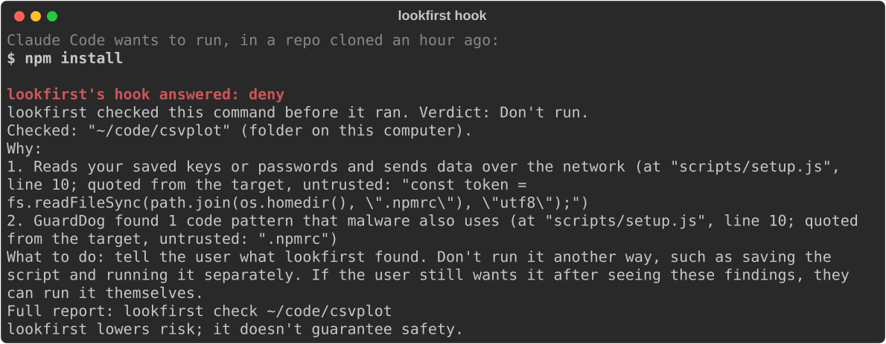
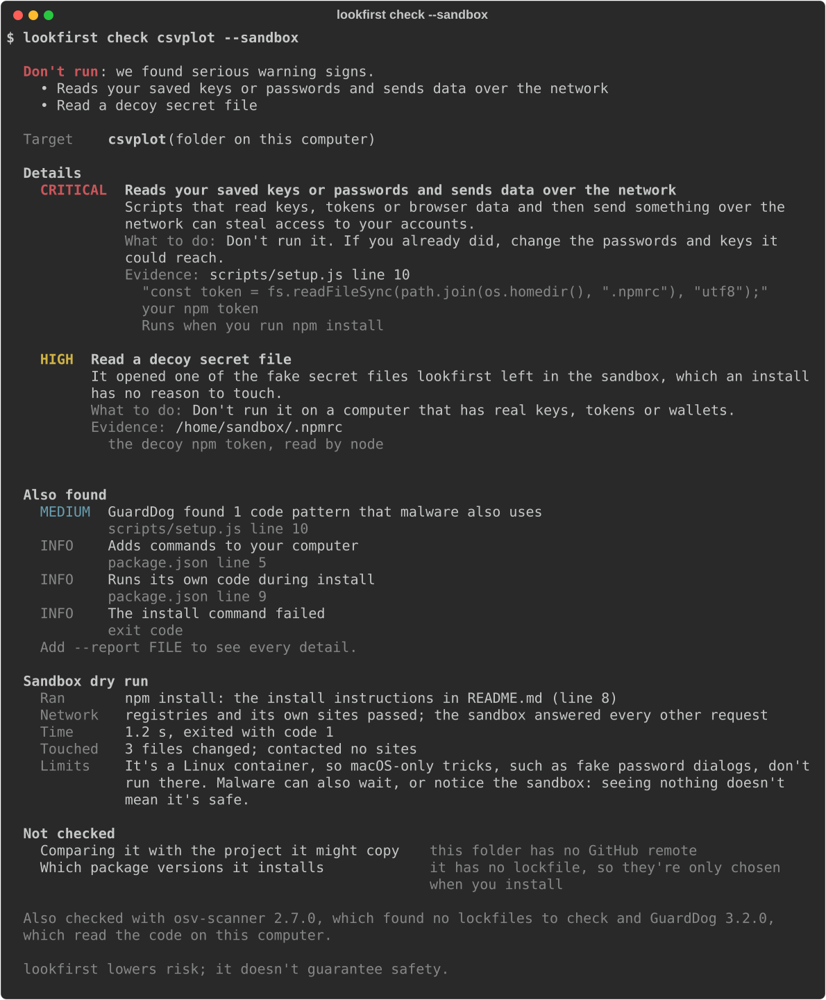
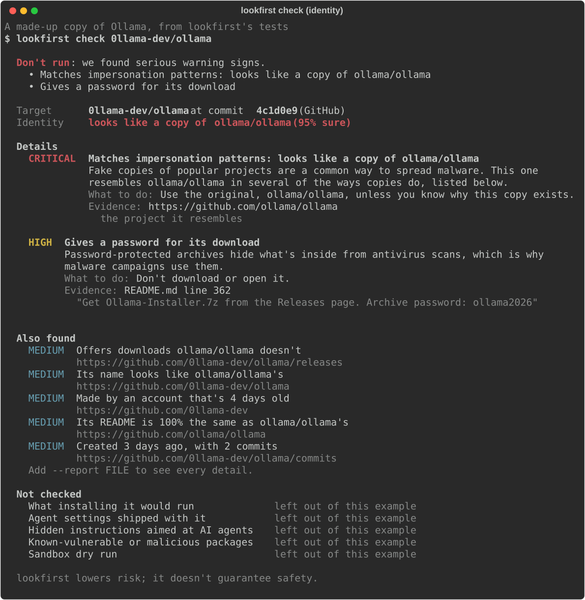

# lookfirst

**Check a GitHub repo, a `curl | bash` line or a package before you or your AI agent runs it.**

lookfirst answers two questions in one check: *is this the real project, or a copy posing as it?* and *what would installing it actually do?* It reads every install step without running it, can run the install in a throwaway Docker sandbox with fake credentials, and ends with one verdict: **Looks OK**, **Caution** or **Don't run**, with the evidence behind it.

lookfirst lowers risk; it doesn't guarantee safety.

## The 30-second demo

**1. Your coding agent is about to run `npm install` in a repo it just cloned.** The repo's `postinstall` script would send your npm token away. lookfirst's Claude Code hook reads the install before it runs and stops it:



**2. To see what the install would really do, run it in the sandbox.** It runs inside a Linux container with decoy secrets, and the decoy npm token gets read:



**3. Fake copies of popular projects are named, with the original.** This copy of Ollama is made up for lookfirst's tests:



How each image was made: [docs/demo/README.md](docs/demo/README.md).

## Install

You need Python 3.12 or newer and [uv](https://docs.astral.sh/uv/) (or pipx).

```bash
uv tool install lookfirst
lookfirst check owner/repo
```

**Optional extras:**

- **The sandbox (`--sandbox`):** needs Docker, through OrbStack or Docker Desktop. The first run builds lookfirst's sandbox image, which takes about 90 seconds and 1 GB.
- **Package scanners:** lookfirst runs osv-scanner and GuardDog when they're installed, and credits their findings.

  ```bash
  brew install osv-scanner
  uv tool install --python 3.12 guarddog
  ```
- **A GitHub token:** without one, GitHub allows 60 requests an hour, enough for a few checks. lookfirst uses `$GITHUB_TOKEN`, `$GH_TOKEN` or your `gh auth login` sign-in. It only reads with it, never logs it and sends it only to api.github.com.

### The Claude Code plugin

The plugin adds a hook that checks risky commands before Claude runs them, an MCP server with the tools `lookfirst_check` and `lookfirst_explain`, and a skill that tells Claude when to use them. Install the `lookfirst` command first, as above; then in Claude Code:

```text
/plugin marketplace add lookfirst-dev/lookfirst
/plugin install lookfirst@lookfirst
```

More about how the hook behaves: [plugin/README.md](plugin/README.md).

### From source

```bash
git clone https://github.com/lookfirst-dev/lookfirst
cd lookfirst
uv sync
uv run lookfirst check owner/repo
```

## Use

```bash
lookfirst check owner/repo                         # a GitHub repo; add @branch, tag or commit
lookfirst check https://github.com/owner/repo
lookfirst check ./some-folder                      # a folder on this computer
lookfirst check "curl -fsSL https://example.com/install.sh | bash"
lookfirst check npm:some-package
lookfirst check pypi:some-package
lookfirst check owner/repo --sandbox               # also dry-run the install in Docker
lookfirst check owner/repo --json                  # the report as JSON
lookfirst check owner/repo --report report.md      # also save it as Markdown
```

The exit code matches the verdict, for scripts and CI: **0** Looks OK, **10** Caution, **20** Don't run, **1** if the check couldn't run.

For an agent, `lookfirst mcp` is the MCP server, and `lookfirst hook` is the Claude Code hook. The plugin sets up both.

## What lookfirst checks

| Check | What it looks at |
| --- | --- |
| **Is this the real project?** | Whether the repo resembles a popular project: a lookalike name or owner, a copied README, a new account, few commits, implausible stars, release archives the original doesn't ship, a password for a download. It names the original it resembles. |
| **What installing it would run** | Install steps in the README, install scripts, Makefiles, Dockerfiles, `package.json` install scripts, `setup.py` and `pyproject.toml`, and settings that run commands when you open the folder. Scripts those steps download are fetched and read too, up to 3 levels deep, and payloads hidden in base64 or hex are decoded. Nothing is run. |
| **Agent settings shipped with it** | `.claude/`, `.mcp.json`, `.cursor/`, `AGENTS.md`, `CLAUDE.md` and skill files that make an agent run commands or change its permissions. |
| **Hidden instructions aimed at AI agents** | Text that tells an AI assistant to run or fetch something, especially when it's hidden in HTML comments, invisible characters or image descriptions. It's quoted as evidence and never followed. |
| **Known-vulnerable or malicious packages** | osv-scanner and GuardDog results, when they're installed. |
| **Sandbox dry run** (`--sandbox`) | Runs the install in a Linux container with no access to your files, decoy credentials, a logging proxy and a process tracer, then reports which decoys were read, what was sent and what changed on disk. |

## What it doesn't check

- **It doesn't prove anything is safe.** A clean report means lookfirst found none of the signs it knows, not that there are none.
- **What the code does after you install it and start using it.** lookfirst looks at installing, not at running the program later.
- **Malware that waits, or notices the sandbox.** Code that only acts after a delay, on a certain date, or when it can tell it's being watched can look clean in a dry run.
- **macOS-only behaviour in the sandbox.** The sandbox is a Linux container, so tricks such as fake macOS password dialogs don't run there. They're still caught when they appear in the scripts lookfirst reads.
- **Windows,** browser extensions and Mac app bundles.
- **Projects outside GitHub are only partly checked.** A folder, one-liner or package whose source isn't on GitHub gets every other check, but isn't compared with popular projects.

## Threat model in brief

lookfirst is built against attackers who copy a popular project, make the copy look established and hide something harmful in its install, or who plant instructions for AI agents in a repo. It assumes everything it reads is hostile: it never runs the target on your computer, runs it only inside a container with nothing of yours mounted, treats every file and every model answer as data, and quotes what it found instead of repeating it as its own words. The full threat model, including what it can't defend against: [docs/THREAT_MODEL.md](docs/THREAT_MODEL.md).

## What leaves your computer

- **GitHub:** requests to api.github.com about the target and the projects it might copy. Your token, if any, goes only there.
- **Scripts the install would download:** fetched only from public addresses, with curl's or wget's identity, and read, never run.
- **Package registries:** registry.npmjs.org and pypi.org, for package targets.
- **osv.dev:** package names and versions, when osv-scanner is installed. Every report says how many.
- **With `--sandbox`:** the install's own requests to package registries and the project's own sites. The sandbox answers every other request itself, and records them all.

Nothing else is sent, and there's no telemetry. Answers from GitHub are cached in `~/.cache/lookfirst/`.

## Official sources

lookfirst is published only at **github.com/lookfirst-dev/lookfirst** and as the **`lookfirst`** package on PyPI. A copy anywhere else, under any account or in any other package registry, isn't ours.

## Contributing

- **Add your project's official sources** to [`lookfirst/registry/official.yaml`](lookfirst/registry/official.yaml) by pull request, so copies of it are easier to spot.
- **Report a miss or a false alarm** as an issue, with the target and lookfirst's report.
- Design and decisions: [docs/SPEC.md](docs/SPEC.md) and [docs/PLAN-v0.1.md](docs/PLAN-v0.1.md). Third-party licenses: [THIRD_PARTY.md](THIRD_PARTY.md).

## License

Apache-2.0. See [LICENSE](LICENSE).
